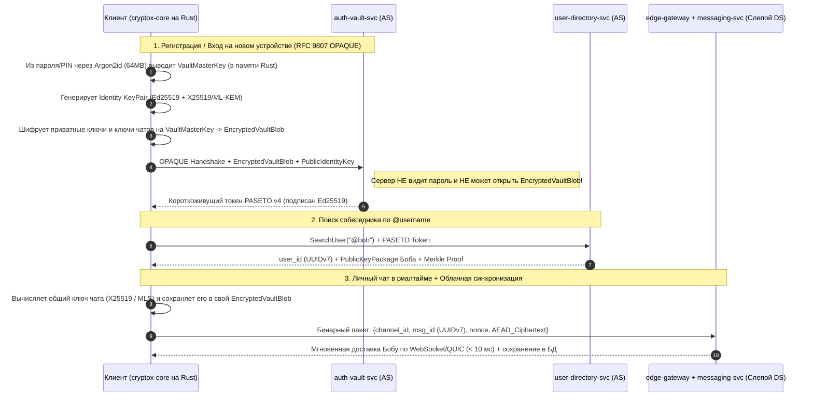

# Генеральный Архитектурный План (`SYSTEM_BLUEPRINT.md`)

## 1. Целевой масштаб и продуктовая задача
- **Сегмент:** Корпоративный B2B/Gov-мессенджер (компании до **100 000+ сотрудников** в одной организации + поддержка множества организаций за счет `tenant_id`).
- **Баланс UX и Безопасности:**
  - **Мгновенная облачная синхронизация** (сотрудник входит с нового ноутбука или телефона и сразу видит всю историю чатов, как в Telegram/Slack).
  - **Zero-Knowledge Server (RFC 9750):** Сервер хранит всю историю и синхронизирует устройства, но только в виде зашифрованных блобов. Ключи от чатов хранятся в **Encrypted Cloud Key Vault**, который расшифровывается исключительно на клиентском устройстве.

---

## 2. Как работает Облачная Синхронизация без сдачи ключей серверу (Encrypted Cloud Key Vault)



---

## 3. Структура Монорепозитория (Cargo Workspace)

```text
C:\cryptox-rust\
├── AGENTS.md                           # Глобальная конституция ИИ-агентов
├── Cargo.toml                          # Корневой Cargo Workspace
├── .agents/
│   ├── rules/                          # Всегда активные правила архитектуры, крипты и тестов
│   └── skills/                         # Специализированные ранбуки (аудит стандартов, бенчмарки, ADR)
├── docs/
│   ├── standards/COMPLIANCE_MATRIX.md  # Матрица стандартов (RFC 9420/9750/9807, CNSA 2.0, OWASP)
│   ├── architecture/
│   │   ├── SYSTEM_BLUEPRINT.md         # Этот документ
│   │   └── adr/                        # Журнал архитектурных решений (ADR)
│   └── benchmarks/                     # Отчеты нагрузочных испытаний каждого модуля (100k SLA)
├── crates/
│   ├── cryptox-proto/                  # Бинарные контракты (Protobuf / gRPC / Wire envelopes)
│   ├── cryptox-core/                   # Клиентское крипто-ядро (Encrypted Vault, E2EE чаты, SQLCipher)
│   └── cryptox-loadgen/                # Асинхронный генератор нагрузки (100k RPS / коннектов)
└── services/
    ├── auth-vault-svc/                 # Изолированный модуль: Авторизация, PASETO v4, хранение Encrypted Vault
    ├── user-directory-svc/             # Изолированный модуль: Поиск по @username и выдача публичных ключей
    ├── messaging-svc/                  # Критический контур: Слепой роутер и облачное хранилище истории чатов
    ├── edge-gateway/                   # Критический контур: Сетевой шлюз (Axum 0.8 WS + Quinn QUIC)
    └── presence-receipts-svc/          # Изолированный модуль: Online/Typing и батчинг 100k Read Receipts
```

---

## 4. Этапы пошаговой разработки и нагрузочных испытаний (MVP Прототип)

1. **Этап 1:** `crates/cryptox-proto` + `crates/cryptox-core` (Контракты + Крипто-ядро + Облачный Сейф Ключей + E2EE сообщений + Юнит/Proptest + Бенчмарк шифрования).
2. **Этап 2:** `services/auth-vault-svc` (Регистрация/Вход, синхронизация зашифрованного сейфа ключей, выдача и верификация `PASETO v4` со скоростью `> 100 000 проверок/сек`).
3. **Этап 3:** `services/user-directory-svc` (Поиск по `@username`, профили, публичные ключи собеседников + нагрузочный тест поиска на `50 000+ RPS`).
4. **Этап 4:** `services/messaging-svc` + `services/edge-gateway` (Риалтайм-переписка по бинарному WebSocket, курсорная облачная история по `UUIDv7`, тест изоляции отказов `Chaos/Bulkhead` и шторм на `100 000 сообщений/сек`).
5. **Этап 5:** Минимальный и быстрый клиентский UI (Логин $\rightarrow$ Поиск `@username` $\rightarrow$ Вход в личный чат $\rightarrow$ Риалтайм переписка и синхронизация истории между устройствами).
