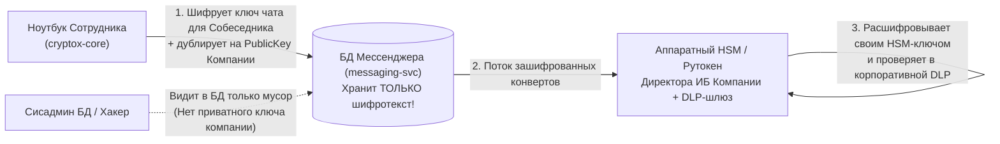

# Юридическая и Архитектурная Модель для Рынка РФ (`RU_ENTERPRISE_COMPLIANCE_AND_DLP.md`)

Этот документ описывает, как архитектура `cryptox-rust` решает юридические требования законодательства РФ (**149-ФЗ / ОРИ / «Закон Яровой»**, **Постановление Правительства РФ № 313 о лицензировании ФСБ на СКЗИ**, **152-ФЗ**) и требования служб информационной безопасности (ИБ / DLP) крупных российских компаний.

---

## 1. Почему за закрытый On-Premise мессенджер НЕ «схватят за жопу» по Закону Яровой (ОРИ)

1. **Кого регулирует закон об ОРИ (ст. 10.1 ФЗ-149 «Об информации»):**
   - Публичные интернет-сервисы (Telegram, WhatsApp и др.), где любой пользователь из интернета может зарегистрироваться, а владелец сервиса сам управляет серверами и трафиком.
2. **Исключение для закрытого контура (On-Premise B2B):**
   - Согласно ст. 10.1 ФЗ-149 и Постановлению Правительства РФ № 743, требования к ОРИ (установка СОРМ и сдача ключей государству разработчиком) **не распространяются** на информационные системы, развернутые юридическим лицом **для собственных внутренних корпоративных и производственных нужд** в закрытом контуре.
   - Мы поставляем компании **коробочное ПО (On-Premise)** в ее собственный закрытый контур. У нас как у разработчика ПО физически нет доступа ни к серверам заказчика, ни к их сети, ни к переписке.

---

## 2. Как не попасть под нарушение ПП РФ № 313 (Лицензия ФСБ на разработку и продажу СКЗИ)

В РФ разработка и продажа средств криптографической защиты информации (СКЗИ) лицензируется ФСБ (Постановление Правительства РФ № 313). Чтобы продавать продукт компаниям на 100% легально (как до получения лицензии ФСБ, так и для госзаказчиков с требованиями ГОСТ), в `crates/cryptox-core` на **Этапе 1** закладывается паттерн **Pluggable `CryptoProvider` Trait**:

1. **Абстракция криптопровайдера (`trait CryptoProvider` в Rust):**
   - Весь код мессенджера вызывает шифрование не напрямую, а через модульный интерфейс `CryptoProvider`.
2. **Три режима поставки:**
   - **Режим A (`ExternalOsOrTlsProvider` / Базовая коммерческая поставка без лицензии ФСБ):** Продукт поставляется как *«Система корпоративных коммуникаций с контролем целостности протокола»*, опирающаяся на штатные криптографические библиотеки ОС или внешние сертифицированные провайдеры заказчика.
   - **Режим B (`StandardAeadProvider` — `ChaCha20-Poly1305` / `AES-256-GCM` / `OpenMLS`):** Внутреннее сквозное шифрование для коммерческих компаний в закрытом контуре.
   - **Режим C (`GostExternalSkziProvider` — Интеграция с КриптоПро CSP / ViPNet CSP по ГОСТ Р 34.12-2018 «Кузнечик» и ГОСТ Р 34.10-2012):** Для банков, госкорпораций и объектов КИИ. Мессенджер не содержит собственного СКЗИ в поставке, а вызывает через FFI/PKCS#11 **уже купленный и установленный самим заказчиком сертифицированный ФСБ модуль (КриптоПро)**. По ПП РФ № 313 в этом случае разработчику мессенджера лицензия ФСБ на распространение СКЗИ не требуется!

---

## 3. Главный секрет продаж в корпорации РФ: «Zero-Knowledge от хакеров и сисадминов, НО прозрачность для Службы Безопасности (DLP) компании»

В корпорации на 100 000 человек владельцем информации является **компания-работодатель**, а не сотрудник.
- Если сделать «глухой партизанский E2EE» (как в Signal), где сама компания не может подключить свою **DLP-систему** (InfoWatch, Solar Dozor, SearchInform) для защиты от слива коммерческой тайны сотрудниками — Служба Безопасности (ИБ) компании **запретит покупку такого мессенджера**.
- С другой стороны, если хранить сообщения на сервере в открытом виде (как в обычных коробочных мессенджерах) — любой сисадмин БД, девопс или хакер, взломавший сервер, сольет всю переписку компании.

### Наше архитектурное решение (Enterprise Key Escrow + Blind Storage):

1. **На сервере мессенджера и в БД (`messaging-svc`) ВСЕГДА лежит только шифротекст.** Ни сисадмин сервера, ни подрядчик, ни хакер при сливе БД, ни разработчик мессенджера прочитать переписку не могут.
2. **У компании-заказчика есть `TenantCompliancePublicKey`** (а его секретная часть хранится **вне сервера мессенджера** — на аппаратном токене Рутокен/JaCarta/HSM у Службы Безопасности компании или на изолированном DLP-шлюзе).
3. **Два режима чатов по политике компании:**
   - **Стандартный рабочий чат (с Corporate Escrow):** Клиент сотрудника автоматически запечатывает ключ чата не только для собеседника, но и для `TenantCompliancePublicKey`. В итоге сервер мессенджера слепой, но DLP-система самой компании (и служба безопасности при внутреннем расследовании или по законному запросу органов к самой компании) имеет полный криптографический доступ.
   - **VIP-режим («Совет Директоров» / Strict E2EE):** Для топ-менеджмента и акционеров политика `Escrow` отключается — ключи есть строго только на устройствах самих директоров.
